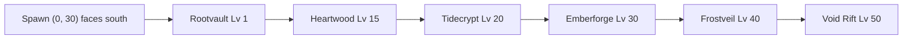

# Gate Plaza

Ghost, 2026-10-17. Docs only. The hub build stays as it is until a later row picks this up.

Players go to a dungeon from here more than from anywhere else. The court is a shallow crescent in front of spawn. Six gates stand in one row, left to right in unlock order, and the walk to each mouth is the same length. The inner court is empty. Vendors sit on the rim, behind the player.

## Where the entries are today

The live hub is the one `HavenBuilder.build` stamps into Workspace. `default.project.json` sets Workspace to `$ignoreUnknownInstances`, and no place file is in the repo. On boot, `SavedWorld` removes every Workspace child except Camera, Terrain, Baseplate, and the default SpawnLocation. That includes an older hub whose boards read "Spawn" and "Dungeon Portals". After `HubSpawn` exists, those defaults are cleared too. The map below is the stamped hub, at floor `Haven.FLOOR_Y` (120).

Spawn is `(0, 30)`, looking north at `(0, 0)`. The five realm arches are south. A new player is facing the Lumen Heart, with the gates behind them.

| thing | where | what it does |
|---|---|---|
| HubSpawn | `(0, 30)`, 12×12 pad | Spawn. Look target is the crystal at `(0, 0)`. |
| Lumen Heart | `(0, 0)`, glass column 8×42×8 on a 22×22 pedestal | Collides. Orbiting shards circle at radius 18–20. |
| Verdant Wilds | arch `(0, 252)` | The only open dungeon prompt. `EnterDungeon = rootvault`. Color `(64, 196, 96)`. |
| Sunken Reach | arch `(-80, 252)` | Closed. Prompt "Coming Soon". Color `(50, 150, 255)`. |
| Emberforge | arch `(80, 252)` | Closed. Color `(255, 150, 40)`. |
| Frostveil | arch `(160, 252)` | Closed. Color `(186, 228, 255)`. |
| Void Rift | arch `(-160, 252)` | Closed. Color `(150, 70, 220)`. |
| The Heartwood | no arch | Story and Normal open from `RaidHud` (queue, premade, Practice). Live level is 15 in `Raids.DIFFICULTIES`. |
| Rootvault Waves | no arch | The "Rootvault Waves" button in `Ui.luau`. The arena is room index `-1`, not a hub gate. |
| NEXT pad | inside each built crawl room | Neon pad 7×0.6×7 at local `(0, 0.4, 28)`, sign "NEXT". Rootvault rooms sit at world z 4140, 4280, 4420, 4560. The pad is 28 studs south of each room origin. Waves is at world z 3860, pad at 3888. |
| Treasure, Shrine, Shop | `DoorHud`, after a cleared Rootvault room | Two screen buttons. The pool is Treasure, Elite, Healing Spring, Shrine, Shop. The last door is the boss. They are not hub prompts. |
| Armory stand | `(-26, 18)`, wood 8×6×2, pad at `(-26, 24)` | Collides. Prompt "Armory / Weapons and armor". This is the live roll stand. The onboarding doc calls it the Roll Shrine. |
| Novice stands | none | No part, prompt, or model is named Novice. T-005's five class pedestals are not built. |
| Waystones | six pillars | Spawn stone `(8, 18)`, Armory stone `(-16, 14)`, portal stone `(18, 244)`, plus Forge, Market, and Pet Garden. They do not collide. The portal stone stands on the shelf, 8 studs in front of the arch line. |

`Tidecrypt` exists in `Dungeons` as an unimplemented Sunken hook (`ascension` 1, no rooms). It has no arch. The Sunken arch does not point at it.

### Distances from spawn `(0, 30)`

Walk speed is 16.

| from spawn to | studs | walk |
|---|---|---|
| Lumen Heart | 30 | 1.9 s |
| Armory stand | 28.6 | 1.8 s |
| Spawn waystone `(8, 18)` | 14.4 | under 1 s |
| Verdant arch | 222 | 13.9 s |
| Sunken or Ember arch | 236 | 14.8 s |
| Void or Frost arch | 274 | 17.1 s |
| Portal waystone `(18, 244)` | 215 | 13.4 s |
| Observatory center `(64, 196)` | 178 | 11.1 s |
| Market center `(-112, 78)` | 122 | 7.6 s |
| South floater rock `(-40, 140)` | 117 | beside the bridge |

Arch centers are 80 studs apart. Void to Frost is 320 studs. The shelf ground is 368 studs wide and 24 deep, centered `(0, 252)`, so it runs `z = 240` to `264`. The plaza is a 104×104 square (`PLAZA_RADIUS` 52). Its south rim is `z = 52`. The bridge from that rim to the shelf is about 188 studs long and 14 studs wide.

Zone names use a billboard 12×2.4 studs that dies at 70 studs (`ShellLayout.ZONE_MAX_DISTANCE`). From spawn, every arch name is out of range. A player on the bridge center reads Verdant only after they pass about `z = 182`. Frost, 160 studs off that line, stays unnamed until they walk the shelf.

### What sits in the way

The south bridge deck itself is clear of colliders. The clutter is the approach, the sight line, and the shelf.

- Spawn looks north. The gates are south. The first thing in frame is the heart, the 22-stud pedestal, and six glass spikes.
- The spawn waystone at `(8, 18)` stands 14 studs off the pad, between the player and the heart.
- The Armory stand collides on the west side of the pad. Its waystone is at `(-16, 14)`. Two townsfolk loops walk the plaza: one at `(16–30, -4–10)`, one at `(-30–-22, -4–8)`, each with a flag 8×20×1.4. A bird circle of radius 18 is centered `(-40, 20)`, over the Armory.
- The observatory is a 64×64 island at `(64, 196)`. Its rock slab (80×80) reaches `z = 236`. The shelf rock starts at `z = 232`. Those undersides overlap under the east arches. The observatory bridge from the origin toward `(64, 196)` leaves the plaza a few studs east of the portal bridge. From the south rim the two decks nearly touch.
- The floater at `(-40, 140)`, diameter 7, sits in the left sight line of the bridge. It does not collide.
- The portal waystone at `(18, 244)` stands in the fan-out in front of Verdant and Ember. Prompt range is 18 studs, and that stone is about 20 studs from the Verdant glow, so the two prompts crowd one approach.
- Heartwood, Waves, Treasure, Shrine, and Shop have no world position, so a player cannot walk to them. NEXT is a room exit 4,000 studs down `+Z`, reached by teleport.

`Progression.UNLOCKS` still lists The Heartwood at level 20. The raid module's Story and Normal rows are level 15. The plaza uses 15.

## The court

One crescent. Spawn stays at `(0, 30)` so `Haven.spawnOnPlaza` keeps passing. The look target becomes the Rootvault mouth, due south. The heart stays at the origin, behind the player, and the path to it stays the north walk that already exists.

Six gates share one circle centered on the spawn pad. Radius 78. Bearings run from south toward east (the player's right when they face `+Z`), step 12°, sweep 60°. Chord between mouths is 16.3 studs. Every mouth is a 4.9 second walk. Rootvault is on the axis. The row then reads left to right: Rootvault, Heartwood, Tidecrypt, Emberforge, Frostveil, Void Rift. Nothing stands to the left of Rootvault, so the first unlock is the gate in front of the camera and each later gate is the next one to the right.

Waves is a second prompt on the Rootvault arch. Practice is a second prompt on the Heartwood arch. They do not get their own arches. NEXT stays in the crawl. Treasure, the run Shrine, and the run Shop stay on `DoorHud`.

The inner court, out to 8 studs short of each mouth, holds floor and a six-stone inlay. No rock, tree, townsfolk, waystone, waterfall, banner, or stall stands inside a lane. A lane is a 10-stud-wide radial corridor from radius 8 to the mouth.

The old realm shelf at `z = 252` and its bridge come down in the blockout. Two rows of arches would split the read. District islands stay where they are. Bridges that currently leave the origin through bearings 0°–70° start at the court rim (radius 96) instead. The observatory bridge is the one that cuts a mouth: at the Tidecrypt point it passes 1.3 studs from the arch. The garden bridge clears the mouths and still crosses the southeast floor, so it starts at the rim too.

### Top view

Studs, `+Z` south, `+X` east. Spawn at the dot. The inlay sits on a radius-8 arc at the same bearings.

```
                         N
                         |
        Shrine           Heart            (pedestal 22 square)
        (28, -40)        (0, 0)
                              stones
                              x = -40
                              z = 18, 10, 2, -6, -14

     Armory (-38, -36)              Shop (-70, 2)
                         |
                        [.] spawn (0, 30)
                         |  look +Z
                    inlay r = 8
                         |
                    Rootvault (0, 108)          bearing 0
                      Heartwood (16, 106)       bearing 12
                        Tidecrypt (32, 101)     bearing 24
                          Emberforge (46, 93)   bearing 36
                            Frostveil (58, 82)  bearing 48
                              Void Rift (68, 69) bearing 60

    court rim radius 96. shelf z=252 is retired.
    each mouth is 78 studs from the dot. chord 16.3.
```



### Studs

| piece | x | z | notes |
|---|---|---|---|
| Spawn pad | 0 | 30 | 12×12. Look at `(0, 108)`. |
| Inlay stones | radius 8, same six bearings | | 2-stud discs, `Haven.LAYER` above the floor, no collision. Lit stone means that gate is open. |
| Rootvault | 0.0 | 108.0 | Bearing 0°. |
| Heartwood | 16.2 | 106.3 | Bearing 12°. |
| Tidecrypt | 31.7 | 101.3 | Bearing 24°. |
| Emberforge | 45.8 | 93.1 | Bearing 36°. |
| Frostveil | 58.0 | 82.2 | Bearing 48°. |
| Void Rift | 67.5 | 69.0 | Bearing 60°. |
| Armory | -38.0 | -35.8 | Rim bearing 210°, radius 76. West of the heart. |
| Shop | -70.5 | 1.5 | Rim bearing 248°, radius 76. The Market prompt moves here. The Market island stays scenery. |
| Shrine plinth | 28.5 | -40.5 | Rim bearing 158°, radius 76. East of the heart. |
| Novice stones | -40 | 18, 10, 2, -6, -14 | Five 4-stud stones, 8 studs apart. West of the pedestal. |

Vendor paths bow around the 22-stud pedestal. They do not cross a gate lane. The south lanes start at `z = 36`.

Arch, every gate, same bones:

| part | size | placement |
|---|---|---|
| Piers | 2.5 × 18 × 2.5 | 8 studs of clear mouth between them. |
| Lintel | 13 × 2.5 × 3 | Underside at 18 studs. |
| Glow | 8 × 14 × 0.6 | In the mouth. Neon. This is the prompt host. |
| Seal | 8 × 1.4 × 1.4 | Across the mouth while the gate is locked. Dark metal, same idea as today's closed arches. |
| Name | billboard 16 × 5 studs | Anchored above the lintel. Two lines. Max distance 96. |

The floor added outside the 104-stud plaza uses `Haven.LAYER` and `Haven.coplanarTops`, same as the bridges, so the new top does not share a face with the plaza.

## Gate spec

Recommended level is one number, the level a new player needs before this gate is the right next place. Difficulty inside a gate stays on the prompt the game already has. The billboard does not list Normal and Hard as separate destinations. V1 has two difficulties, Normal and Hard (Lv 5); there is no Nightmare (decision 10, Oct 23, 2026).

| order | gate | arch | color | biome | billboard | party line | lock |
|---|---|---|---|---|---|---|---|
| 1 | Rootvault | A split trunk, two bent piers, a low thorn lintel. Mouth reads as a gap in a hedge. | `(64, 196, 96)` | Choked wood. Wet stone, dark leaf, one pale shaft. | `Rootvault` / `Lv 1 · Solo` | Solo. Second prompt on the right pier: `Waves`. | Open from level 1. Hard opens at level 5, chosen after Enter. No Nightmare in V1. |
| 2 | The Heartwood | The same trunks, blackened, with an amber crack through the lintel. Taller by 4 studs so it marks the raid without leaving the row. | `(92, 140, 72)` body, crack `(214, 140, 64)` | The wood after the fire. Ash, sap, no flowers. | `Heartwood` / `Lv 15 · 4–8` | `Finder` on the glow. `Practice` on the right pier, solo, the line `tip_37` already uses. | Closed until level 15. Reason on the seal: `Opens at level 15.` Story before Normal stays inside the raid screen. |
| 3 | Tidecrypt | A salt-crystal arch, two leaning slabs, a thin lintel. | `(50, 150, 255)` taken down to `(36, 96, 140)` | Drowned stone. Tide sheen. No foam toys. | `Tidecrypt` / `Lv 20 · Sealed` | `4–8` once it exists. | `Sunken Reach is sealed.` Level 20 from the realm table. `ascension` 1 is not the painted level. |
| 4 | Emberforge | Black slag piers, a cracked lintel, heat only in the seams. | `(255, 150, 40)` in the seams, stone `(28, 26, 28)` | A forge that has gone cold. | `Emberforge` / `Lv 30 · Sealed` | `4–8` later. The raid name in the raids doc is The Crucible. The arch keeps the realm name. | `Emberforge is sealed.` |
| 5 | Frostveil | One clear pier and one broken pier, a flat ice lintel. | `(186, 228, 255)` as an edge, fill `(150, 176, 190)` | Still ice. Long sight. | `Frostveil` / `Lv 40 · Sealed` | `4–8` later. | `Frostveil is sealed.` |
| 6 | Void Rift | A grey ring with a violet inner edge. The mouth is almost empty. | `(150, 70, 220)` only on the inner edge. Fill `(18, 16, 24)` | Thin color. No face in the stone. | `Void Rift` / `Lv 50 · Sealed` | `4–8` later. | `Void Rift is sealed.` |

Lock copy is one sentence a phone can read without opening a prompt. An open gate leaves the seal off and lights its inlay stone. A locked gate keeps the seal, dims the glow to transparency 0.75, and leaves the inlay dark.

Rootvault's recommended level stays 1 for the whole beta. The subline gains `· Hard` at level 5 so the arch tells the truth about what Enter will offer. There is no Nightmare in V1. It still does not become two arches.

### Vendors on the rim

| stall | prompt | role |
|---|---|---|
| Armory | `Armory` / `Weapons and armor` | The live roll stand, moved off the pad. The Roll Shrine name from the onboarding doc is this stall. |
| Shop | `Market Board` / `Browse and trade` | The Market district prompt, moved to the rim. Stalls on the Market island can stay as shape. |
| Shrine | `Shrine` / `The shrine wakes inside a run.` | A closed plinth. It does not roll Might, Ward, or Haste, and it does not open a door. Those remain the Rootvault door. The plinth is here so the word Shrine has a home that is not in a lane. |
| Novice stones | no prompt in the blockout | Five class stones for T-005. Grey. No glow. They are not gates and they are not vendors. |

Treasure has no stall. It remains the door button after a cleared room.

## Light and VFX

Cool, dim, and specific. One local light per gate. No face, no sparkle burst, no flower, no firefly in the court. The forge ember cap is the budget reference: particle rate at or under 8, shadows off, light range at or under 18.

| gate | light | particles | mood |
|---|---|---|---|
| Rootvault | PointLight `(64, 196, 96)`, brightness 0.45, range 16. | A slow mist, rate 6, lifetime 1.2–2.0, drifting up the trunk. | Damp shade. The shaft is a 1-stud neon column inside the mouth, transparency 0.5. |
| Heartwood | PointLight `(214, 140, 64)`, brightness 0.35, range 14. Pulse 0.15 brightness over 3 seconds. | Ash motes, rate 5, dark grey to dull amber. | A raid door that is still a tree. The crack holds the only warm pixel in the row. |
| Tidecrypt | PointLight `(36, 96, 140)`, brightness 0.4, range 14. | A thin sheet down each pier, rate 4, pale teal. | Pressure and a cold shine. The mouth is darker than the piers. |
| Emberforge | PointLight `(255, 120, 40)`, brightness 0.3, range 12. | Seam sparks, rate 6, short lifetime 0.3–0.6. | Heat trapped in stone. The air stays dark. |
| Frostveil | PointLight `(186, 228, 255)`, brightness 0.4, range 16. | No flakes. A still wisp, rate 3, almost white. | Hard cold. The broken pier has no light of its own. |
| Void Rift | PointLight `(120, 60, 180)`, brightness 0.2, range 10. | None. | The edge is the effect. The mouth stays near black. |

Neon on the glow part is what the player reads at noon, when `HavenLife` raises the sun. The point light is fill. Billboard text is `(236, 226, 190)` with stroke transparency 0.35, the same ink as today's zone signs. Locked glows lose the light and keep a faint neon edge so the arch is still a shape.

Sounds stay quiet. A locked gate is silent. An open gate may use the existing hub ambience. No new music id.

## Phone

Roblox `FieldOfView` is the vertical angle, default 70. In portrait 9:16 the horizontal angle is about 43°. At 78 studs that frame is about 61 studs wide, which covers Rootvault, Heartwood, and most of Tidecrypt when the camera looks straight south. The other three gates come in as the player turns right. Landscape at about 102° holds the full 60° sweep.

That is the intended read. The inlay at the feet is the whole row when the phone can only hold three arches. Six stones, left to right, the lit ones open. Radius 8 is inside the spawn pad's south edge and inside arm's reach.

- The name billboard is 16×5 studs, two lines, max distance 96, `AlwaysOnTop` false so it stays off the HP bar. At 78 studs the block is about 40 pixels tall on an 800-pixel-tall phone, about 20 pixels a line. The acceptance check is a portrait shot from the pad: the Rootvault name is readable, and the subline is readable or it hides and the inlay carries the level.
- Words stay short. `Lv 15 · 4–8`. `Lv 20 · Sealed`. The long reason sits on the seal, in the prompt's `ObjectText`, once the player is close.
- Prompt reach is 8 studs, indicator 10. Today's 18-stud reach would light two mouths at once: the chord is 16.3. Enter lives on the glow. Waves and Practice live on the right pier.
- The mouth is 8 studs, one person wide. A party gathers on the court, then the lead walks in. The lane is 10 studs and empty.
- No SurfaceGui on the arch. A board in the mouth becomes a wall of letters on a phone and sits where the player walks.
- The seal and the dim glow have to read with particles off and with the graphics tier that already strips trim. The shape carries the lock. The particle is extra.

## Milestones

Three build rows. M1 is T-141 and landed in #142 (`4da2997`). M2 is T-144. M3 is T-145. This section first used T-138, T-139, and T-140 while those ids were still free. Those ids are other rows now: T-138 is the Verdant playtest, T-139 is the playtest HUD, and T-140 is the Roll crack reveal.

### T-141 Blockout

Done in #142 (`4da2997`). The acceptance below is what landed.

Owner GHOST. Files: `src/ReplicatedStorage/Shared/Haven.luau` (spawn look, gate and vendor coordinates), `src/ServerScriptService/ShardfallServer/HavenBuilder.luau` (court floor, six arches, empty lanes, vendor pads, five stones), `tests/Haven.spec.luau`, `tests/HavenBuild.spec.luau`. Leave `DungeonService` room pads alone. Leave NEXT where it is. No schema bump. No new remote.

Acceptance:

- Spawn at `(0, 30)` looks at the Rootvault mouth. `Haven.spawnOnPlaza` still passes.
- Six block arches stand on the coordinates in the stud table, chord 16.3, radius 78, bearings 0 through 60 step 12.
- A 10-stud lane from radius 8 to each mouth contains no part taller than the floor inlay.
- The shelf at `z = 252`, its bridge, and the portal waystone are gone.
- The observatory bridge and the garden bridge start at the court rim and miss every mouth by at least 8 studs.
- Armory, Shop, and the closed Shrine plinth stand on the rim coordinates. The Armory prompt still says `Armory`. The Shop prompt still says `Market Board`.
- Five grey stones stand at `x = -40`, `z = 18, 10, 2, -6, -14`, with no prompt.
- Rootvault's glow prompts Enter. Heartwood's glow prompts the existing raid queue. Locked gates prompt their one-line reason and do not teleport.

### T-144 Gate visuals

Owner GHOST. Files: `HavenBuilder.luau` (arch dressing, seal, billboard), `Haven.luau` if the gate table grows a color and a lock string. No new HUD. No schema bump.

Acceptance:

- Each arch matches its row in the gate spec: silhouette, color, two-line billboard, party line, seal.
- Open and locked states follow the live rules: Rootvault open at level 1, Heartwood closed until level 15, the four realms sealed with their level on the subline.
- The inlay stone lights only for an open gate, in the same left-to-right order.
- A locked glow is transparency 0.75, seal on, light off. An open glow is the biome color, seal off.
- From the spawn pad in a portrait frame, Rootvault's name is readable. Prompts at 8 studs do not offer two gates at once.
- Waves stays on the Rootvault pier. Practice stays on the Heartwood pier. Treasure, the run Shrine, and the run Shop stay on `DoorHud`.

### T-145 Polish and VFX

Owner GHOST. Files: `HavenBuilder.luau` (lights and emitters), a short note in `tests/HavenBuild.spec.luau` that each gate has one light and a rate at or under 8. No new audio id. No schema bump.

Acceptance:

- Each gate matches the light and VFX table. Shadows are off. Range is at or under 18. Rate is at or under 8. Void has no emitter.
- The court has no flower, firefly, face, or sparkle burst.
- With the day cycle at noon, the neon mouth still reads. With particles stripped, the seal still reads.
- A portrait pass from the pad shows one open name, the inlay, and an empty lane. A turn to the right brings the sealed gates in without a prop in the way.
- The townsfolk loops and the south floater are outside every lane.

## Change log
- 2026-10-23 (Prism, per Ghost's decision 10, Kevin pre-approved): difficulty is Normal + Hard (Lv 5) only; Nightmare removed. Matches the Gate dock in the first-30-seconds spec (#412) and Crater Square (#413).
