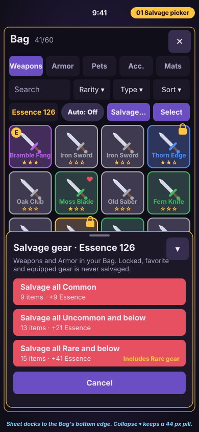
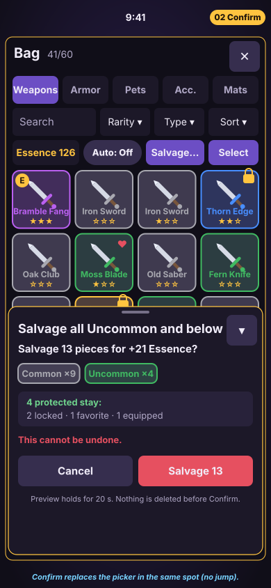
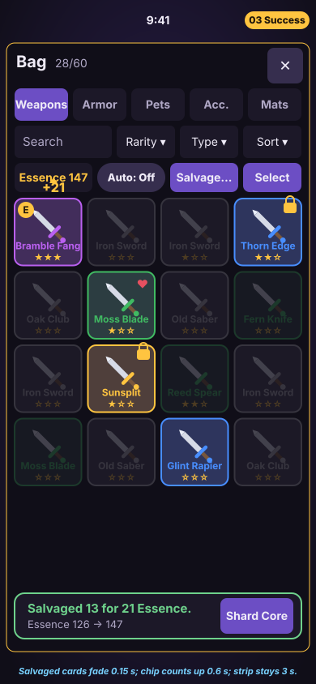
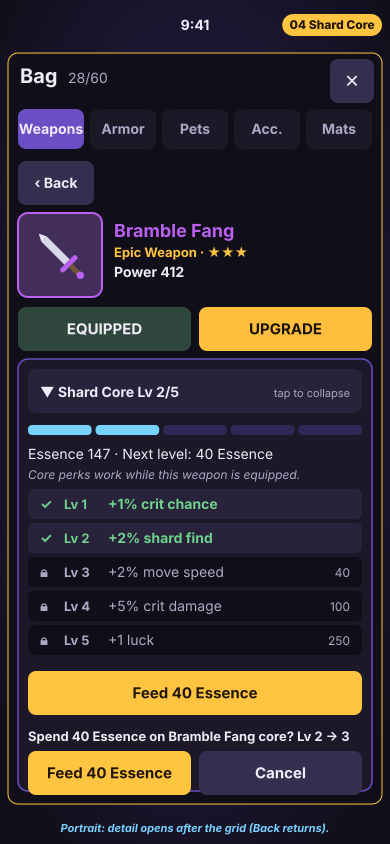
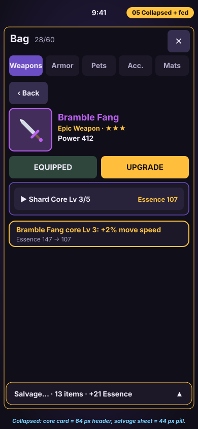

<cursor_untrusted_data_1337 source="CallDynamicTool">

# Shardfall: Bag Salvage… flow + Shard Core panel, Build Spec v1.1

**Status:** Draft for Ghost (UI) and Echo (server). Docs only, with no code and no flags.

**v1.1 (Oct 23, 2026):** this is the single salvage + Shard Core spec. It folds in closed PR #400 (this text and its 5 SVG mockups) and supersedes `SPEC_v1.md` from the same PR. Ghost's answers from #15 comment [6380154154](https://github.com/Itsm00k21/Shardfall/issues/15#issuecomment-6380154154) are applied:
- GearBar row controls and the Shard Core **Feed** button are **44 px tall on phones** (desktop may stay 36 visual with a 44 hit box).
- `CoreCard` is **restyled to the pack chrome** (§6 tokens replace its own `DEFAULT` table).
- Echo may add the token-free **`counts`** read (§9 Echo 1).
- `CoreCard` in the detail pane is the **only Shard Core UI in V1**. `ShardCore/Mount` is **not used in V1**; this spec does not propose deleting its code.
- Q1, Q2, Q4, Q7 and the 410-Essence pacing note were decided by Ghost on Oct 23, 2026 under Kevin's pre-approval (see §11 and the Decision log; Kevin can change any later). Essence-cap behavior and `expired = true` are Echo's call (Ghost leans: refuse at 0 gain, yes to `expired`).

**Asked for in:** #15 comment [6379856660](https://github.com/Itsm00k21/Shardfall/issues/15#issuecomment-6379856660), item 5: "a spec and mockups for the Bag's Salvage… flow and the Shard Core panel (Essence balance, the per-weapon core and its perks), using the same pack chrome. No code."
**Sources read (read-only):** `cursor/live-build-9721` @ `49bd902`: `Shared/GearSalvage.luau`, `Shared/Config/Essence.luau`, `Shared/Config/ShardCore.luau`, `Shared/GearHooks.luau`, `server/ShardCore/*`, `ShardfallClient/CoreCard.luau`, `ShardfallClient/ShardCore/{Mount,View}.luau`. `ghost/bag-intro-fixes` @ `33f1147` (the "Salvage…" BulkPicker in `GearBar.luau`). PR #392 `docs/ui/reference/STYLE.md` + `OWNERSHIP.md` (the pack). PR #388 (server auto-cap at Uncommon), PR #393, Echo's review [6378950270](https://github.com/Itsm00k21/Shardfall/issues/15#issuecomment-6378950270). Notion: Combat & Gear, Crafting, Gear & Customization.

**Rule for numbers:** a number marked **(code)** is already defined in the repo and this spec does not change it. A number marked **(proposal)** is Prism's suggestion and needs a yes from Ghost or Kevin. Questions are in §11.

**Ownership:** `GearBar`, `GearDetail`, `CoreCard`, `GearHooks`, `InventoryHud`/`InventoryLayout` and `MenuHub` are Ghost's (OWNERSHIP.md). Prism edits none of them. Everything in §9 marked Ghost is a request to Ghost, and everything marked Echo is a request to Echo.

---

## Scope: V1 now vs later

**V1 now (this spec):**
- The Bag's **Salvage…** picker (3 rarity rows) → **confirm** (with a breakdown and the protected count) → **success** (Essence count-up).
- The **Shard Core card** for the selected weapon (CoreCard in the detail pane): the Essence balance, Lv pips, the perk ladder, Feed → inline confirm → toast.
- **Collapse** for both: the salvage sheet becomes a 44 px pill, and the core card becomes its 64 px header.
- Edge cases (fast taps, an expired preview, server refusals, Essence full, an empty Bag) and the phone layouts.

**Later (scope creep, not in V1):**
- The standalone all-weapons **ShardCore/Mount** panel (a weapon list). CoreCard notes say "Clip 4: the all-cores picker is gone", so V1 has one Shard Core surface. **Decided (Ghost, 6380154154):** `ShardCore/Mount` is not used in V1; its code stays for now.
- Showing the **dupes past 5 stars → Essence** overflow (the `GearSalvage.grant` seam, Stage A). The reveal line already supports "· +N Essence" (`GearHooks`). That needs a short roll-reveal addendum, not this spec.
- A per-item thumbnail list inside the confirm, undo or recovery of salvaged gear, other Essence sinks, pet cores (code: "Pets have no core"), Forge material salvage (Notion's older Crafting page; see note at end), and Salvage/Feed SFX.
- A saved "first time" flag (it needs a save field; §11 Q7).

---

## 1. Goal
The player turns gear they don't need into **Essence** in two taps with a clear preview, then spends that Essence to level the **Shard Core** of the weapon they use, for small permanent perks. Nothing is for sale, and nothing costs Robux.

## 2. Where it lives (how it's opened and collapsed)

**Salvage…**
- Location: the Bag (the one centered Inventory window, opened with **B** or the **Bag** rail button). The button is `BulkSalvage` "Salvage…" in the GearBar row (`GearRow`), shown **only on the Weapons and Armor tabs** (code, 33f1147). Pets are never salvaged.
- It opens the **Salvage sheet** (`BulkPicker`). The sheet docks to an edge of the Bag window, never to the screen center (layout in §4).
- **Collapse:** a ▾ button (44×44) in the sheet header folds it into a **44 px pill**, "Salvage…  ·  13 items · +21 Essence ▴", docked at the same edge. Tapping the pill expands it and re-checks the counts. **Close** is Cancel, or the Bag's ✕. Switching tabs away from Weapons/Armor closes the sheet (no token is kept).
- The sheet's collapsed or open choice is remembered for the session only (proposal).

**Shard Core**
- Location: the Bag detail pane, as `CoreCard` under EQUIP / UPGRADE, **for Weapons only** (code: `kind == "Weapon"`, no pet feeder). On a portrait phone the detail opens after the grid (‹ Back returns), per STYLE.md. On desktop and landscape it's the right-hand detail column.
- The card opens on its own when a weapon is selected (`open` defaults to true, code).
- **Collapse:** tap the header "▼  Shard Core  Lv 2/5" to fold it to the header row ("▶  Shard Core  Lv 2/5", plus "Essence N" on the right). The choice is kept for the session through `onToggle` (code hook). There is no separate close: the card lives and dies with the detail pane.
- **Essence balance** shows in two places: the GearBar chip "Essence N" (code) and the core card's line "Essence N  ·  Next level: C Essence" (code).

## 3. Flow

**A. Salvage… (bulk by rarity)**
1. Bag → Weapons or Armor tab → tap **Salvage…**. Any open dropdown, the Auto-salvage popover, and any confirm close (code `openBulk`).
2. The sheet opens with three rows. Each row shows the client estimate (muted) right away, then the server's count (normal text) once it answers:
   - "Salvage all Common", line 2 "9 items · +9 Essence"
   - "Salvage all Uncommon and below", "13 items · +21 Essence"
   - "Salvage all Rare and below", "15 items · +41 Essence", plus a gold tag "Includes Rare gear" (proposal)
   A row with 0 items reads "Nothing to salvage" and is dimmed (code).
3. The player taps a row with items. The client asks the server for a fresh **preview** of that rarity (a token, valid 20 s, code) and shows a ~0.4 s "Checking…" line if the reply is slow (proposal).
4. The **Confirm** view replaces the picker in the same spot (no jump):
   - Title: the row's title, e.g. "Salvage all Uncommon and below"
   - "Salvage 13 pieces for +21 Essence?"
   - Rarity chips: "Common ×9", "Uncommon ×4" (rarity color border and text)
   - Protected box: "4 protected stay:" / "2 locked · 1 favorite · 1 equipped" (from the preview's `skipped` list, grouped by reason)
   - "This cannot be undone." in danger color
   - Buttons: **Cancel** (left, buttonDim) and **Salvage 13** (right, danger)
5. Tap **Salvage 13**. The button switches to "Salvaging…" right away and ignores more taps. The client sends `confirm {token}`.
6. **Success:** the sheet closes. The salvaged cards fade out (0.15 s), the Essence chip counts up from the old to the new value (0.6 s) with a gold "+21" floater, and a status strip at the bottom of the Bag window reads "Salvaged 13 for 21 Essence." / "Essence 126 → 147", with a **Shard Core** shortcut button (proposal: it selects the equipped weapon and scrolls to its core card).
7. **Cancel or back:** Cancel in the picker closes the sheet. Cancel in the confirm returns to the **picker** (proposal; today it closes everything) with the counts kept. Collapse ▾ at any step keeps what's on screen and deletes nothing. The Bag ✕, B, or a tab switch closes everything, and the token is dropped. **Nothing is deleted before step 5.**

**B. Salvage selected (already in code, kept)**
Select → tap cards → the bar reads "Salvage N for +X Essence" → the same Confirm view, with the body "Salvage N for +X Essence? This cannot be undone." plus " K picked item(s) are protected and stay." when needed (code text) → success as in A6.

**C. Shard Core feed**
1. Select a weapon card. The detail pane shows the core card for that weapon.
2. The card shows: 5 pips (filled to the level), "Essence 147  ·  Next level: 40 Essence", the line "Core perks work while this weapon is equipped." (proposal; code applies perks only for the equipped weapon), the 5-row perk ladder, and **Feed 40 Essence** (gold) or **Feed 40 Essence  (have 12)** (dim) or **Core maxed** (dim).
3. Tap **Feed 40 Essence**. An inline confirm opens under it: "Spend 40 Essence on Bramble Fang core?  Lv 2 → 3" with **Feed 40 Essence** / **Cancel** (code).
4. Confirm: the button reads "Feeding..." (code) and ignores more taps. The client sends `FeedShardCore(uid)`.
5. **Success:** the toast reads "Bramble Fang core Lv 3: +2% move speed" (code `fedText`). The new pip and the new perk row glow gold for 2.5 s (code `FRESH_SECONDS`), and the Essence chip counts down 0.4 s (proposal).
6. **Cancel or back:** Cancel hides the inline confirm. Tapping Feed again toggles it. Tapping the header collapses the card. ‹ Back (portrait) returns to the grid. Nothing is spent before step 4.

## 4. Layout

All sizes are in px at 1× unless marked as scale. **On phones, GearBar row controls and the Feed button are 44 tall (decided, Ghost 6380154154).** On desktop, visual controls can stay 36 tall (pack `CONTROL_H` 36), but **every tappable thing has a hit box of at least 44×44** (`UiTheme.TOUCH`). Safe area: lay out inside `ScreenInsets.CoreUISafeInsets`, and keep 12 px from any safe-area edge. Nothing in this spec sits over the screen center outside the Bag window.

**Breakpoints** (same as the pack): portrait phone = Bag body narrower than 600 (`stacked()`); landscape phone = short side 500 or less and wider than tall; desktop = everything else.

| Piece | Desktop (1280×720+) | Phone portrait 390×844 | Phone landscape 667×375 | Phone landscape 800×400 |
|---|---|---|---|---|
| Salvage sheet anchor | Inside the Bag window, AnchorPoint (1,1), Position UDim2(1,-10,1,-10): bottom-right, over the detail column, never over the grid's middle third | Bottom sheet: AnchorPoint (0.5,1), Position UDim2(0.5,0,1,-8) inside the Bag window | Side sheet: AnchorPoint (1,0.5), Position UDim2(1,-8,0.5,0) inside the Bag window | Same as 667×375 |
| Sheet size | W 340, H auto (max 0.6 × Bag height, then scroll) | W = Bag width − 8 (≈ 366), H auto, max 0.5 × viewport (422), top edge never above y 422 | W 300, H = Bag height − 16, scrolls | W 320, H = Bag height − 16, scrolls |
| Collapsed pill | 44 tall, W 340, same anchor | 44 tall, W = sheet W, same anchor | 44 tall, W 300, AnchorPoint (1,1) bottom-right | 44 tall, W 320, bottom-right |
| Picker row | 52 tall, full width, gap 8 | 52 | 52 | 52 |
| Confirm buttons | 2 side by side, each (W−28−8)/2 × 44 | (≈169) × 44 | (≈132) × 44 | (≈142) × 44 |
| Header collapse ▾ | 44×44, top-right of the sheet, 12 px inset | same | same | same |
| Core card | Full width of the detail column (`InventoryLayout.detailW`), AutomaticSize Y | Full Bag width − 20, under EQUIP/UPGRADE, in the detail ScrollingFrame | In the right detail column, scrolls | same |
| Core header | 44 tall button (code `UiTheme.TOUCH`) | 44 | 44 | 44 |
| Pips | 5 segments, H 10, gap 4, width scale 1/5 − 4 px (code) | same | same | same |
| Perk row | ≥ 30 tall (proposal; code is AutomaticSize text 14) | 30 | 30 | 30 |
| Feed / inline confirm | 44 tall (code); confirm buttons 0.5 scale − 4 px each (code) | same | same | same |
| Success strip | Bottom of the Bag window, AnchorPoint (0.5,1), W = Bag W − 20, H 56 | same | AnchorPoint (0,1) under the grid, W 0.6 × Bag W | same |

Notes:
- On a portrait phone the Bag already covers the character, so "off center" here means the sheet lives in the **lower half** of the Bag and the grid stays readable above it (mockup 01).
- On landscape phones the side sheet covers the **detail column**, not the grid (the pack keeps detail on the right in landscape).
- Echo flagged `HudLayout.luau:708` (the card crossing center on narrow screens) in 6378950270. This spec doesn't depend on it, but Ghost should fix it before the Bag is checked at 667×375.

## 5. States

| State | Salvage sheet | Shard Core card |
|---|---|---|
| **Empty** | All 3 rows read "Nothing to salvage", dimmed (buttonDim). A tap shows the status "Salvage all Common: nothing to salvage." and sends nothing (code). If the Bag has no weapons or armor: the help line "No unlocked, unequipped weapons in Weapons." (code `pickEmpty` style) | No weapon selected: the card isn't built. The weapon has core Lv 0: all pips empty (track 46,40,86), all perks locked |
| **Loading** | Rows show the client estimate in muted text. Once the server answers, the text turns normal (`Server` attribute, code). Slow replies (> 0.4 s) show "Checking…" (proposal) | "Feeding..." on the confirm button (code) |
| **Normal** | Rows with items are filled danger 230,80,96 (code) with white text | Pips filled cyan (core 120,210,255, code) up to the level. Unlocked perks in ok 110,210,140 with ✓. Locked perks muted with 🔒 and their unlock cost on the right (proposal) |
| **Full** | Essence at the 1,000,000,000 cap (code): the server answers "Essence is full." The confirm shows it in danger and the salvage button is disabled | Core at Lv 5 (code `CAP`): the Feed button reads "Core maxed", dimmed, and the line says "Essence N  ·  Core maxed" (proposal) |
| **Error** | Server text in the status line, danger color, 3 s (proposal). Sheet stays open | The server reason via `onStatus(why, "error")` (code), and the button text resets |
| **Locked** | Flag `gearSalvage` off: the Salvage… button is hidden (proposal; today BagTools shows "That is closed.") | Flag `shardCore` off: no card (code `enabled()`) |
| **Disabled** | While a preview or confirm is in flight, rows and buttons are dimmed and ignore taps (`busy`, code) | Feed dimmed when Essence < cost: "Feed 40 Essence  (have 12)" (code). A tap shows "Need 40 Essence (you have 12)." (code) |

## 6. Numbers

**Economy (all code, unchanged):**
- Essence per salvaged piece (`Config/Essence.AMOUNT`): Common **1**, Uncommon **3**, Rare **10**, Epic **40**, Legendary **200** (Mythic and Secret are folded to 200).
- Core cost to the next level (`ShardCore.COST`): **5, 15, 40, 100, 250**, so **410** in total to reach the cap of **5**.
- Perks (cumulative, `ShardCore.PERKS`): Lv1 "+1% crit chance", Lv2 "+2% shard find", Lv3 "+2% move speed", Lv4 "+5% crit damage", Lv5 "+1 luck". They're added flat after equip totals, **only for the equipped weapon** (`Perks.apply`).
- Preview token life **20 s** (`GearSalvage.TOKEN_SECONDS`). GearSalvage remote rate limit **capacity 4, 1/s** (#388).
- Auto-salvage cap is **Uncommon** at most (pack, #388). The manual picker goes up to **Rare** (`GearHooks.BULK_CAPS`).

**Timings (proposal unless marked):**
| Moment | Time |
|---|---|
| Sheet open (phone: slide up 24 px + fade; desktop: fade + scale 0.96→1) | 0.18 s, Quad Out |
| Collapse / expand | 0.15 s |
| "Checking…" appears if the server hasn't answered | after 0.4 s |
| Salvaged cards fade | 0.15 s |
| Essence chip count-up / count-down | 0.6 s / 0.4 s |
| "+N" floater: rise 16 px and fade | 0.8 s |
| Success strip / error line on screen | 3 s |
| Fresh pip + perk glow after a feed | **2.5 s (code)** |
| Pip fill tween | 0.25 s |

**Colors (RGB, pack chrome):**
| Token | RGB | Used for |
|---|---|---|
| bg | 16,14,24 | Bag window |
| panel | 28,24,40 | Sheet, core card fill (proposal; CoreCard today uses 24,20,52) |
| row | 40,34,58 | Core header, unlocked perk rows (proposal; code 36,30,74) |
| text | 240,236,248 | Body |
| muted | 176,168,198 | Help, locked perks, estimates (proposal; CoreCard uses 170,162,200) |
| button | 108,78,196 | Salvage…, Select, Cancel (picker), core card stroke 1.5 (proposal; code 120,86,220) |
| buttonDim | 54,46,78 | Cancel (confirm), empty rows, disabled Feed (proposal; code 58,52,88) |
| gold | 255,196,64 | Essence text, Feed fill, fresh glow, "+N" floater, popup stroke @0.5 |
| ink | 32,22,10 | Text on gold (proposal; CoreCard uses 24,18,12) |
| danger | 230,80,96 | Salvage rows, Salvage N button, "This cannot be undone." |
| ok | 110,210,140 | Unlocked perks, protected line, success strip border |
| core | 120,210,255 | Filled pips (code; §11 Q4) |
| Rarity | Common 168,168,176 · Uncommon 64,186,98 · Rare 72,142,255 · Epic 186,96,240 · Legendary 255,196,64 | Chips and card borders, from `Rarities.rgb`. Never hardcode |

**Type and shape:** BuilderSansBold for buttons, titles and names; BuilderSans for body; BuilderSansExtraBold for the auto pill. Sizes: sheet title 18, row title 15, row line 13, help 13, confirm body 15, chips 13, buttons 15, core header 14, perks 14, min 14 except the pack's 13 help lines. Corners: sheet/popup 12, buttons 8, core card 10, chips 8, pips 4. Padding: popup 14/12, list gap `UiTheme.PAD` 8, core card 10/10.

**Exact text** (code unless marked):
- Button: "Salvage…" · Sheet title: "Salvage gear  ·  Essence N" · Help: "Weapons and Armor in your Bag. Locked, favorite and equipped gear is never salvaged."
- Rows: "Salvage all Common" / "Salvage all Uncommon and below" / "Salvage all Rare and below". Line 2: "N items · +X Essence" / "Nothing to salvage". Tag: "Includes Rare gear" (proposal)
- Confirm body (bulk, proposal; it splits code's one line into blocks): "Salvage N pieces for +X Essence?" · chips "Common ×9" · "K protected stay:" / "2 locked · 1 favorite · 1 equipped" · "This cannot be undone." · buttons "Cancel" / "Salvage N" (proposal; code uses "Confirm")
- Success: "Salvaged N for X Essence." · Errors: "That confirm expired. Look again." · "The bag changed. Look again." · "That item is a favorite." · "That item is locked." · "Unequip it before salvaging." · "Essence is full." · "Pick gear to salvage." · "Nothing of that rarity can be salvaged." · "Could not salvage that."
- Core: "Shard Core  Lv 2/5" · "Next level: 40 Essence" / "Next level: 40 Essence (you have 12)" · "Feed 40 Essence" / "Feed 40 Essence  (have 12)" / "Core maxed" · "Spend 40 Essence on Bramble Fang core?  Lv 2 → 3" · "Feeding..." · "Bramble Fang core Lv 3: +2% move speed" · "Core perks work while this weapon is equipped." (proposal)
- Core errors (server): "Shard Core is off." · "Slow down a moment." · "Not enough Essence." · "That core is at its cap." · "Only a weapon has a Shard Core." · "You do not have that item." · "Could not feed that core."

## 7. Edge cases
- **Bag full:** salvage is the way out, and it never adds items. The roll's "Salvage now" nudge (`nudge` + `salvageNow`, code) should open this same Confirm view so there's one look (proposal). Salvage works with the Bag at 60/60.
- **Fast or double taps:** Confirm, Feed and the row taps lock on the first tap (`busy`) until the reply. One tap means one `confirm` call, so Essence goes up once. Rapid row taps: only the last tapped row's preview counts (the server keeps one token per player).
- **Three previews on open (Echo P2):** today the picker fires 3 token-minting previews in a row, so a fast Confirm can hit the rate limit (capacity 4, 1/s). Proposal: Echo adds a token-free `counts` read that returns all three rows in one call. The token is minted only when a row is tapped (§9, §11 Q5).
- **Preview expired (over 20 s on the confirm):** the server answers "That confirm expired. Look again." The client re-runs the preview **once** on its own, updates the numbers, and shows "Numbers updated. Check and confirm again." (proposal). It never auto-confirms.
- **The Bag changed between preview and confirm** (an item favorited, locked or equipped elsewhere): the server answers "The bag changed. Look again." or the block reason, and deletes nothing. The client returns to the picker with fresh counts.
- **Server refuses or the flag is off:** show the reason. Nothing is removed locally until the server says ok (no optimistic delete).
- **A weapon with a Shard Core level is salvaged:** cores are keyed by item uid, so salvaging that weapon loses the Essence spent on it. Proposal: bulk sweeps skip weapons with core Lv 1+ (counted as "1 has a Shard Core" in the protected box), and an explicit select shows a warning line. Needs Kevin's call (§11 Q1) and an Echo server rule.
- **Essence near the cap:** if a sweep would pass 1,000,000,000 the server refuses with "Essence is full." The confirm says so.
- **First time:** the sheet's help line gets one extra line the first time: "Essence feeds a weapon's Shard Core." (proposal), and the success strip's **Shard Core** button points the player to the next step. It's shown once per session unless Kevin wants a saved flag (§11 Q7).
- **Duplicate weapons:** each copy has its own core (uid). The card always names the selected copy.
- **Selected weapon salvaged elsewhere while its card is open:** the card closes with the detail pane, and the grid returns.

## 8. Mockups
Portrait phone 390×844, pack colors, fake data. They're committed as SVG (vector, exact RGB) because binary upload isn't available to the committing tool. JPG renders are kept locally by Prism.

| # | File | State |
|---|---|---|
| 01 | `mockups/01-salvage-picker.svg` | Salvage sheet open: 3 rows with counts, the Rare tag, Cancel, collapse ▾ |
| 02 | `mockups/02-salvage-confirm.svg` | Confirm: rarity chips, protected box, "This cannot be undone.", Cancel / Salvage 13 |
| 03 | `mockups/03-salvage-success.svg` | Success: salvaged cards faded, "+21" floater on the Essence chip, success strip with the Shard Core shortcut |
| 04 | `mockups/04-shard-core-panel.svg` | Detail pane: Bramble Fang, core Lv 2/5, perk ladder, Feed 40 Essence, inline confirm |
| 05 | `mockups/05-collapsed-and-fed.svg` | Core card collapsed to its header after a feed (toast "Bramble Fang core Lv 3: +2% move speed"), salvage sheet collapsed to its 44 px pill |

    

## 9. Build split

**Ghost (UI, Ghost-owned files):**
1. `GearBar` BulkPicker: the dock and anchors per §4 (bottom sheet on portrait, side sheet on landscape, bottom-right on desktop); the collapse ▾ and the 44 px pill; the "Includes Rare gear" tag; row controls 44 px tall on phones (decided).
2. `GearBar` SalvageConfirm: the bulk confirm laid out as blocks (title, question, rarity chips, protected box grouped from `skipped`, "This cannot be undone."); side-by-side Cancel / "Salvage N"; Cancel returns to the picker; "Salvaging…" lock; the single auto re-preview on an expired token.
3. Success feedback: card fade, Essence chip count-up and "+N" floater, success strip with the **Shard Core** shortcut.
4. `CoreCard`: switch its `DEFAULT` colors to the pack tokens in §6 (decided yes); add the line "Core perks work while this weapon is equipped."; show the unlock cost on locked perk rows; add "Core maxed" to the Essence line at Lv 5.
5. Point the roll's "Salvage now" nudge at the same Confirm view.

**Echo (server, `GearSalvage` / `ShardCore`):**
1. A token-free `counts` action on the `GearSalvage` remote: `{ rarities = {"Common","Uncommon","Rare"} }` returns `{ Common = {count, gain}, ... }` in one call, with no token and nothing deleted (fixes the 3-preview P2).
2. Preview replies keep the `skipped` list with a `reason` per uid, so the client can group "locked / favorite / equipped" (already there; confirm the shape is stable).
3. If §11 Q1 is yes: weapons with `shardCores[uid] >= 1` are skipped in rarity sweeps with the reason "That weapon has a Shard Core.", and an explicit list containing one fails like a favorite does. Add tests.
4. No new save fields in V1. `schemaVersion` stays 26.

## 10. Pass criteria (Kevin can check these in a playtest)
1. At 390×844: Bag → Weapons → **Salvage…** opens a sheet in the lower half of the Bag. The rows show counts. "Uncommon and below" → Salvage: afterwards every locked, favorite and equipped item is still in the Bag, and the Essence chip went up by exactly the previewed amount.
2. Cancel, collapse ▾, Bag ✕ or a tab switch at any step deletes nothing (the Bag count is unchanged).
3. Double-tapping **Salvage N** or **Feed** does it once (Essence changes once).
4. Select a weapon → the core card shows Lv 0/5 → Feed 5 Essence → confirm → it reads Lv 1/5, "+1% crit chance" glows gold for about 2.5 s, and Essence drops by 5. With too little Essence the button reads "Feed 15 Essence  (have 3)" and spends nothing.
5. At 390×844, 667×375, 800×400 and desktop, every button is at least 44 px tall, nothing overlaps, the sheet never covers the grid's center on desktop or landscape, and both panels collapse to a pill or header of 64 px or less.

## 11. Open questions
Echo decides: salvage at the Essence cap (refuse at 0 gain, or delete with clamped gain) and `expired = true` on stale tokens.

1. ~~@Kevin: Protect weapons with a Shard Core at Lv 1+ from bulk salvage?~~ **Yes (Ghost, Kevin pre-approved).** Cored weapons (Lv 1+) are skipped by every bulk salvage and auto-salvage, the same way favorites are; they can only be salvaged one at a time from the detail pane. Server work is Echo's (queued on Echo's row).
2. ~~@Kevin: Keep the "Salvage all Rare and below" row?~~ **Yes, keep it (Ghost, Kevin pre-approved).** Auto-salvage stays capped at Uncommon.
3. ~~@Ghost: Restyle `CoreCard` to the pack chrome (panel 28,24,40, row 40,34,58, stroke 108,78,196, muted 176,168,198, ink 32,22,10) instead of its own `DEFAULT` table?~~ **Yes (Ghost).**
4. ~~@Kevin: Filled core pip color?~~ **A, cyan 120,210,255 (Ghost, Kevin pre-approved).** Matches current code, so no change. Gold stays the "just fed" glow.
5. ~~@Ghost: OK for Echo to add a token-free `counts` read?~~ **Yes (Ghost).**
6. ~~@Ghost: Is CoreCard the only Shard Core UI for V1?~~ **Yes (Ghost).** Mount is not used in V1; no code deletion proposed.
7. ~~@Kevin: First-time help line once per session or once ever?~~ **A, once per session (Ghost, Kevin pre-approved).** No new save field. Echo's small client/session flag is queued on Echo's row.

---
**Note for Kevin (not a question):** Notion's Crafting page (Oct 15) still says salvage gives realm **materials** at the Forge. The repo's Stage B pays **Essence** instead (#388/#390). This spec follows the repo. The Notion page can be updated when you're ready (Prism won't edit it without an ask).
**Pacing observation (code numbers, unchanged):** one full core costs 410 Essence, which is about 137 Uncommons, 41 Rares, or 2–3 Legendaries. It's worth watching in playtests; it isn't a change request.
**Decided (Ghost, Kevin pre-approved):** keep 410 Essence for now and tune `ShardCore.COST` in Config after the playtest.

## Decision log
- 2026-10-23 (Ghost, Kevin pre-approved, board row https://app.notion.com/p/403c31ca388381c0bb72d75abab9bd4d): Q1 = **yes**, protect Shard Core Lv 1+ weapons from bulk salvage. Q2 = **yes**, keep "Salvage all Rare and below". Q4 = **A** cyan pips. Q7 = **A** help line once per session. The salvage tip ships (Ghost decision 1). Total core cost stays **410 Essence**, tuned in Config after playtest. All §11 questions are now closed.

</cursor_untrusted_data_1337>
